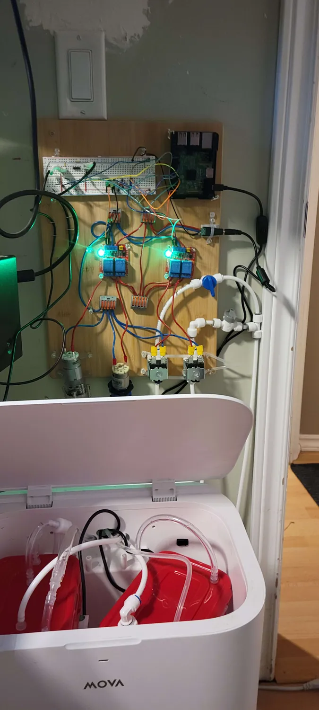
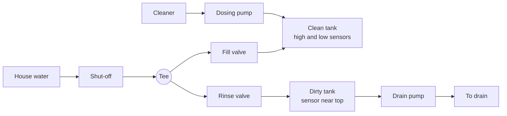
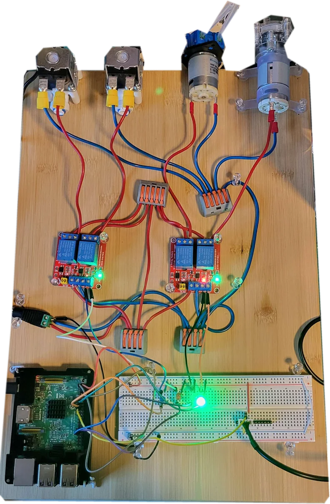
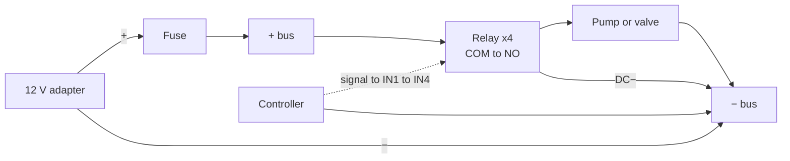
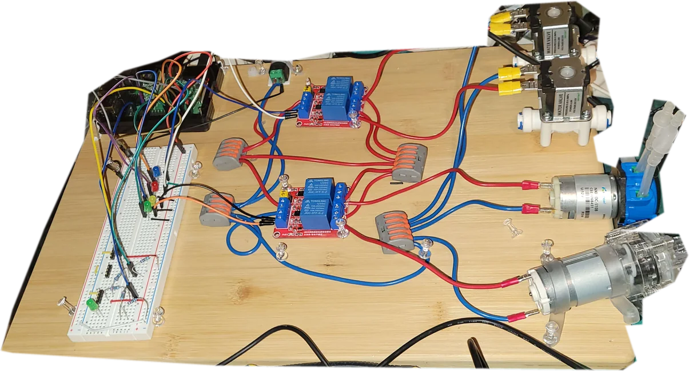
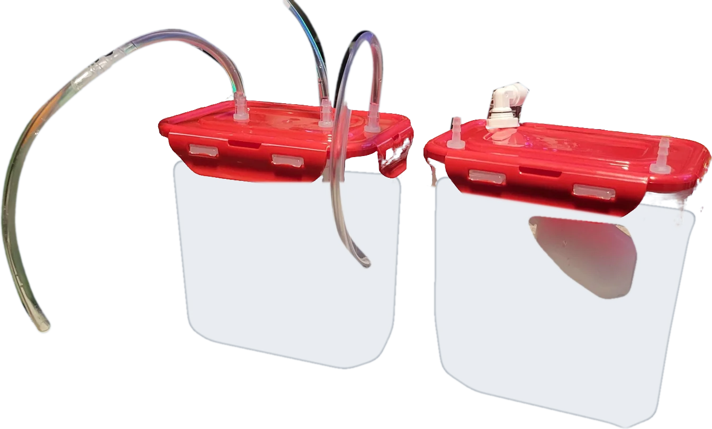
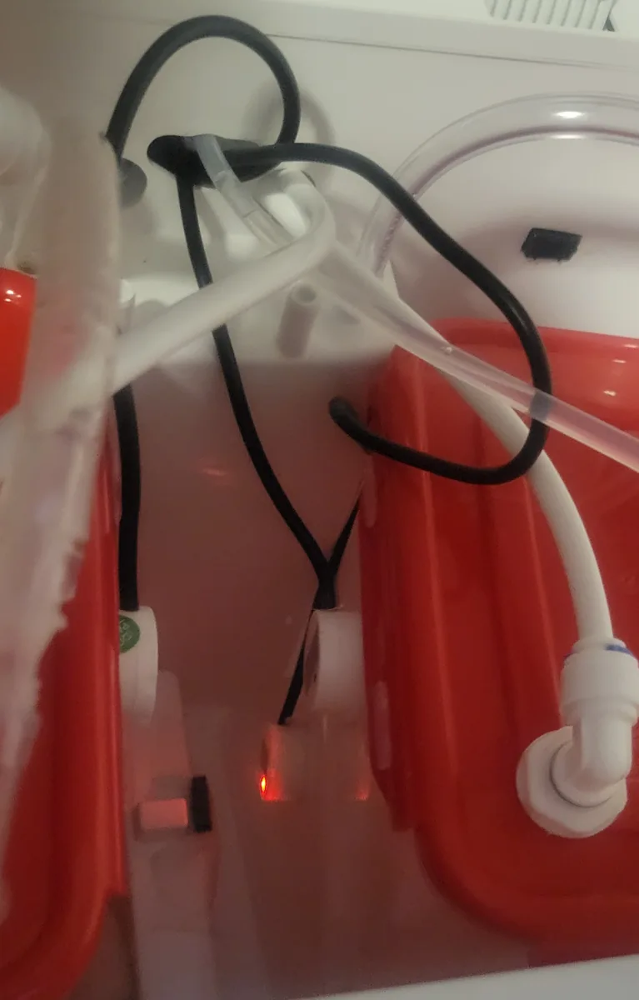
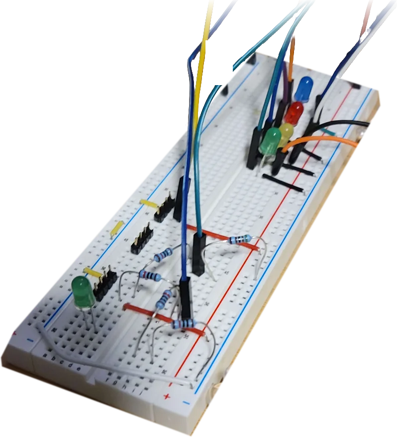
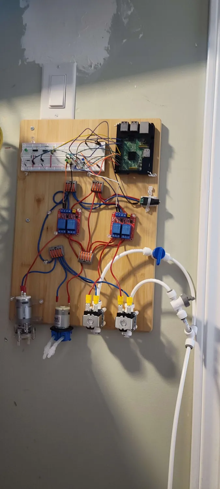

# Build your own Clanker Cleaner

> This is the Markdown version of the [build guide](https://brendenbowers.github.io/ClankerCleaner/guide/).

A small controller that empties a robot vacuum dock's dirty tank, rinses it, and refills the clean tank, so you stop carrying water by hand.

We built ours for a MOVA P10 Ultra, but the idea suits any dock with tanks you can reach. Each part below is listed by what it does, with the one we used as an example.



> **This connects low-voltage electronics to house water, unattended.** Build it at your own risk. Modifying your dock may void its warranty. A stuck valve or split tube can flood a room, so keep a shut-off valve in reach and check the plumbing for leaks before you leave it running.

## How it works

Two sensors watch the tanks and a controller switches four 12 V loads through relays.

- **Dirty tank:** when the sensor sees water, the pump drains the tank. A valve then lets in a short rinse, and the pump drains that too.
- **Clean tank:** when the low sensor goes dry, a valve fills the tank until the high sensor sees water or time runs out. A small pump then adds cleaner.



## Parts

Anything that does the same job will work. The examples are what we used, so check that sizes and voltages suit your dock before you buy.

### Controller and switching

| Part | What it does | Qty | Our example |
| --- | --- | --- | --- |
| Microcontroller | Runs the firmware and connects to Wi-Fi | 1 | [Freenove ESP32-S3 WROOM (N16R8)](https://www.amazon.ca/dp/B0FRRJCDHF). A Raspberry Pi also works: it's what the photos show. |
| 12 V relay module, 2-channel, high/low trigger | Switches each 12 V load from a 3.3 V signal | 2 | Red relay boards with JQC-3FF 12 V relays |
| 12 V power adapter, 3 A | Powers the relays, pumps and valves | 1 | [Arkare 12 V 3 A](https://www.amazon.ca/dp/B0G1YX9JCZ) |
| DC screw-terminal jack | Connects the adapter to bare wire | 1 | 5.5 x 2.1 mm female jack |
| Inline fuse holder and 3 A fuse | Cuts the 12 V feed on a short | 1 | Recommended: any 18 gauge holder |

### Pumps, valves and sensors

| Part | What it does | Qty | Our example |
| --- | --- | --- | --- |
| 12 V self-priming diaphragm pump | Drains the dirty tank | 1 | [Gikfun R385](https://www.amazon.ca/dp/B09ZX4TFNG) |
| 12 V normally-closed solenoid valve | Lets in rinse water and fill water. Closed when unpowered. | 2 | [DIGITEN 1/4" quick-connect](https://www.amazon.ca/dp/B016MP1HX0) |
| 12 V peristaltic dosing pump | Adds cleaner to the clean tank | 1 | [Kamoer NKP](https://www.amazon.ca/dp/B07GWJ78FN) |
| Non-contact liquid level sensor | Sees water through the tank wall | 3 | [XKC-Y25](https://www.amazon.ca/dp/B088NQ5JQ4): one NPN for the dirty tank, two PNP for the clean tank |
| Flyback diode | Protects the relays from the spike when a pump or valve turns off | 4 | Recommended: 1N5819, one across each load |

### Tanks and plumbing

| Part | What it does | Qty | Our example |
| --- | --- | --- | --- |
| Clip-lid food container | Stands in for the dock's tank, with a lid you can drill. The dirty tank's should seal airtight and preferably not flex under vacuum. | 2 | Clear containers with red clip lids, sized to fit the dock |
| Float valve | Stops the fill mechanically, even if a valve sticks open | 1 | [Malida adjustable float valve](https://www.amazon.ca/dp/B01N43RMXR) |
| Barbed bulkhead fittings | Carry tubes through the tank lids | As needed | Nylon barbs sealed into the lids |
| Clear silicone or vinyl tube | Dip tube, drain line and vacuum line. The vacuum line's tube must not collapse under vacuum. | About 3 m | 1/4" ID tube |
| 1/4" OD water line | Carries clean water to the valves | As needed | White push-fit line |
| 1/4" push-fit tee and elbows | Splits the supply to both valves | As needed | [Lemoy 1/4" fittings](https://www.amazon.ca/dp/B07Q5N5M6C) |
| Ball valve | Shuts the water off by hand | 1 | 1/4" push-fit valve with a blue handle |
| Water supply tap | Takes water from a cold line | 1 | A tee or saddle kit that suits your plumbing |
| Backflow preventer | Keeps tank water out of your drinking water | 1 | A dual check valve. Check your local plumbing code. |

### Mounting and small parts

| Part | What it does | Qty | Our example |
| --- | --- | --- | --- |
| Mounting board | Holds everything, and hangs on the wall | 1 | Bamboo cutting board |
| Lever wire connectors | Join the 12 V and ground wires | 4 | 5-port grey and orange lever connectors |
| Solderless breadboard | Holds the sensor resistors and signal wiring | 1 | Full-size 830-point breadboard |
| Resistors, 10 kΩ and 15 kΩ | Pull-up and voltage dividers for the sensors | 3 and 2 | Any 1/4 W resistors |
| Stranded hookup wire | Red for 12 V, blue for ground | A few metres | 18 to 22 gauge |
| Crimp terminals | Connect wire to the pump and valve tabs | 8 | Insulated female spade terminals |
| 4-wire cable | Runs the sensors to the board. Each cable serves up to two sensors. | 2 | Old USB cables, cut to length |
| 4-pin connectors | Let you unplug a tank's sensors | 2 pairs | JST connectors |
| Jumper wires | Connect the controller, breadboard and relays | 1 pack | Dupont jumpers |
| Fixings | Hold parts to the board | As needed | Clear push pins, cable ties and screws |

## Tools

- Wire strippers and a crimping tool
- Soldering iron and heat-shrink, for the sensor joints
- Multimeter
- Drill and step bit for the tank lids
- Small screwdrivers
- A Windows PC with Git, for building the firmware

## 1. Mount the parts

1. Lay everything out before you fix anything. Put the valves and pumps along the edge nearest the dock, so their tubes reach it.
2. Keep the controller and breadboard at the far end, away from the pumps and water.
3. Fix the relay boards, lever connectors, pumps and valves to the board.
4. Let the valves and pumps hang over the edge if that makes their tubes easier to reach.



*Our layout: valves and pumps at one end, relays in the middle, controller and breadboard at the other. The photos show our first Raspberry Pi version.*

## 2. Wire the power

The 12 V side has one rule: power goes through a relay to each load, and every load returns to a shared ground.



1. Run the adapter's positive through the fuse to a lever connector. This is your + bus.
2. Run its negative to a second lever connector. This is your − bus.
3. From the + bus, wire `DC+` on each relay board and the `COM` terminal of all four relays.
4. From each relay's `NO` terminal, wire the positive of one load. Using NO means the load is off whenever the relay is off.
5. Wire each load's negative, and `DC−` on each relay board, to the − bus.
6. Fit a flyback diode across each load, with the stripe on the positive side.
7. Set each relay board's trigger jumper to **H**, so 3.3 V turns a relay on.



*Red wires are 12 V, blue wires are ground. The lever connectors make up the + and − buses.*

> All the loads share the adapter's 3 A. They add up to about 1.7 A, leaving room for motors starting up, but don't add more loads without checking the total.

## 3. Wire the controller

Connect the controller's ground to the − bus with a single wire, so pump current never flows through it. Then wire the signals below. The sensors get their own step once the tanks are ready.

| Signal | ESP32-S3 | Raspberry Pi (GPIO, header pin) |
| --- | --- | --- |
| Pump relay (IN1) | GPIO38 | GPIO17, pin 11 |
| Rinse valve relay (IN2) | GPIO39 | GPIO27, pin 13 |
| Fill valve relay (IN3) | GPIO40 | GPIO5, pin 29 |
| Dosing pump relay (IN4) | GPIO41 | GPIO6, pin 31 |
| Dirty tank sensor | GPIO1 | GPIO22, pin 15 |
| Clean tank high sensor | GPIO42 | GPIO26, pin 37 |
| Clean tank low sensor | GPIO21 | GPIO23, pin 16 |

Avoid these ESP32-S3 pins for anything else: GPIO35 to 37 (used by the memory), 0, 3, 45 and 46 (boot mode), 19 and 20 (USB), and 43 and 44 (serial console).

## 4. Prepare the tanks

1. Check that your containers fit the dock's tank bays and that the dock's own connections still reach them.
2. **Dirty tank:** drill the lid for the dock's inlet, the drain dip tube and the rinse inlet. Run the dip tube to the bottom of the tank.
3. **Clean tank:** drill the lid for the fill line, the cleaner tube and the dock's outlet. Fit the float valve so it closes before the tank overflows.

> **The dirty tank's vacuum line.** The dock uses vacuum on the dirty tank, so this tank needs more care than the clean one:
>
> - The lid and every fitting must be airtight.
> - Keep the vacuum port above the water line.
> - Use tube that won't collapse under vacuum.
> - Preferably, choose a tank that doesn't flex when vacuum is applied.



*Our tanks with their lid fittings. The right one has the float valve inside. The tank bodies are softened in this image to hide the background.*

## 5. Wire the sensors

The sensors sit on the outside of the tanks, so no wiring goes near the water. We ran them to the board with old USB cables, cut and fitted with JST connectors.

### Fix the sensors to the tanks

1. Fix each sensor flat against the side of its tank: one near the top of the dirty tank, and one near the top and one near the bottom of the clean tank.
2. Keep the gap between sensor and wall as small as you can. The XKC-Y25 datasheet asks for under 0.5 mm, and suggests an epoxy-type glue.
3. Keep them clear of spots where water runs down the wall, and away from settled silt.



*Our sensors on the sides of the tanks, in the gap between them, with the black USB cables running down to them.*

### Make the cables

A USB cable has four wires, which is what two sensors need: 5 V, ground and one signal each. So the clean tank's two sensors share one cable, and the dirty tank's sensor uses another with a wire to spare.

| USB wire | Clean tank cable | Dirty tank cable |
| --- | --- | --- |
| Red | 5 V to both sensors | 5 V |
| Black | Ground to both sensors | Ground |
| White | High sensor signal | Sensor signal |
| Green | Low sensor signal | Spare, for a second sensor |

1. Cut the plugs off two old USB cables, and strip the four wires. Ignore any bare shield wire or foil.
2. Check each wire with a multimeter. These are the usual colours, but cheap cables vary.
3. At the tank end, join the sensors' brown wires to the 5 V wire, their blue wires to ground, and each yellow wire to its signal. Insulate every joint.
4. Tape off each sensor's black mode wire.
5. Fit a 4-pin JST connector to each cable, so a tank can be unplugged and lifted out.
6. Label both ends of each cable, and keep the same pin order on both.

> **Never plug these cables into a USB port.** They carry sensor signals now, not USB.

### Connect them to the ESP32-S3

> **Never put 5 V on a GPIO pin.** The sensors run on 5 V, but the controller's inputs take 3.3 V at most. Power each sensor and measure its signal wire before you connect it.

| Sensor | Signal wiring | Wet reads |
| --- | --- | --- |
| Dirty tank (NPN) | Straight to GPIO1, with a 10 kΩ resistor from GPIO1 to 3.3 V | Low |
| Clean tank high (PNP) | Through 10 kΩ to GPIO42, with 15 kΩ from GPIO42 to ground | High |
| Clean tank low (PNP) | Through 10 kΩ to GPIO21, with 15 kΩ from GPIO21 to ground | High |

The 10 kΩ and 15 kΩ pair turns the PNP sensor's 5 V into a safe 3 V. Keep these resistors at the controller end, so only the safe voltage reaches the pin. Power the sensors from the controller's 5 V pin and ground.



*The sensor resistors on the breadboard. The coloured LEDs were test lights for the relay signals, and you can leave them out.*

## 6. Load the firmware

1. Clone [the repository](https://github.com/brendenbowers/ClankerCleaner).
2. Copy `esp32/Secrets.example.h` to `esp32/Secrets.h` and fill in your Wi-Fi details. Git ignores this file. Your dock's cloud account goes here too, if you want the mop wash and dock status.
3. Install the tools. This downloads about 2 GB into the project's `.cache` folder:

   ```
   scripts\esp-idf.cmd install
   ```
4. Build the firmware:

   ```
   scripts\esp-idf.cmd build
   ```
5. Connect the board's UART USB port, then flash it and watch the log. Use your own COM port:

   ```
   scripts\esp-idf.cmd -p COM3 flash monitor
   ```

After that you can update it over Wi-Fi. The [README](https://github.com/brendenbowers/ClankerCleaner#esp32-firmware) covers that, the Raspberry Pi build and everything else in more detail.

## 7. Test it dry

Do this before any water is connected. The board may try to fill as soon as it starts, because an empty tank is what it's meant to fix.

1. With the controller unplugged from the relays, power the 12 V side and measure each relay input to ground. It should read about 0 V, and nothing should run.
2. Connect the controller and watch the log. Each sensor's level is logged at startup and when it changes.
3. Hold a wet hand or a cup of water against each sensor, and check that the log shows the right pin changing.
4. Check that each relay clicks and the right load runs. If they're swapped, fix the wiring before you add water.

## 8. Connect the water

1. Turn off the water, and fit your supply tap to a cold line.
2. Run the line through the backflow preventer and the shut-off valve, then to a tee.
3. Run one side of the tee to the fill valve and the other to the rinse valve. Follow the arrow on each valve.
4. Connect the fill valve to the clean tank, and the rinse valve to the dirty tank.
5. Connect the dirty tank's dip tube to the drain pump, and run the pump's outlet to your drain.
6. Run the dosing pump's tubes from your cleaner bottle to the clean tank.
7. Open the water slowly and check every joint for leaks. Check again after a full cycle.



*Wall-mounted with the water connected. The blue handle is the shut-off.*

> Use a low-foam cleaner made for robot mops, at the strength on its label. Foam and the wrong chemicals can damage the robot.

> Check your valve's minimum pressure. Ours needs 0.02 MPa, so it suits a pressurised line, and it may not open on a gravity feed.

## 9. Add the dashboard (optional)

The controller runs on its own, but it can also report to an MQTT broker. The `dashboard/` web app then shows live status and can send these commands:

| Command | What it does |
| --- | --- |
| `drain` | Runs the drain pump, without a rinse |
| `rinse` | Runs the rinse and leaves the water in the tank. Stops if the sensor goes wet. |
| `fill` | Fills the clean tank, without adding cleaner |
| `add_cleaner` | Runs the dosing pump once. It doesn't check the water level, so make sure the tank has water in it. |
| `stop` | Turns everything off and holds the automatic runs |
| `resume` | Restarts the automatic runs |

A tank that's busy refuses a command, so commands can't interrupt a run. Only `stop` does that. See the [README](https://github.com/brendenbowers/ClankerCleaner#esp32-firmware) to set up a broker.

## Timings

These are our settings on the ESP32. Yours will depend on your pump and tank size. Change them in `src/Config/Config.ESP32.cpp`, or in the config file on a Raspberry Pi.

| Setting | Ours | Why it matters |
| --- | --- | --- |
| Pump run | 90 s | How long one drain takes |
| Extra when full | 30 s | Added if the sensor is wet when the drain starts |
| Pump limit | 600 s | Longest it keeps pumping during a mop wash |
| Rinse | 7 s | How long the rinse valve stays open |
| Pump after rinse | 45 s | How long it pumps out the rinse water |
| Sensor debounce | 10 s | How long a reading must hold before it counts |
| Fill limit | 60 s | Longest the fill valve stays open |
| Cleaner dose | 15 s | How long the dosing pump runs per fill |

## Troubleshooting

| What you see | Check |
| --- | --- |
| A relay is on as soon as it boots | The trigger jumper should be on H. |
| A sensor reads the opposite of what it should | Check whether it's NPN or PNP, and that the black mode wire isn't connected. |
| A sensor never changes | Press it flatter against the wall, or turn its sensitivity knob. Counter-clockwise is more sensitive. |
| The drain stops and stays stopped | The sensor was still wet when the run ended. Look for a blockage or an air leak, then send `resume` or restart. |
| The fill stops and stays stopped | The low sensor was still dry when time ran out. Check the water supply and the valve. |
| The dock can't pull water into the dirty tank | Check that the lid and fittings are airtight, and that the vacuum line hasn't collapsed. |
| The controller resets when a pump starts | Check the flyback diodes and the adapter's current rating, and keep the controller's ground on a single wire to the − bus. |

Part of the [ClankerCleaner](https://github.com/brendenbowers/ClankerCleaner) project. Clanker Cleaner is a personal project, not affiliated with MOVA.
